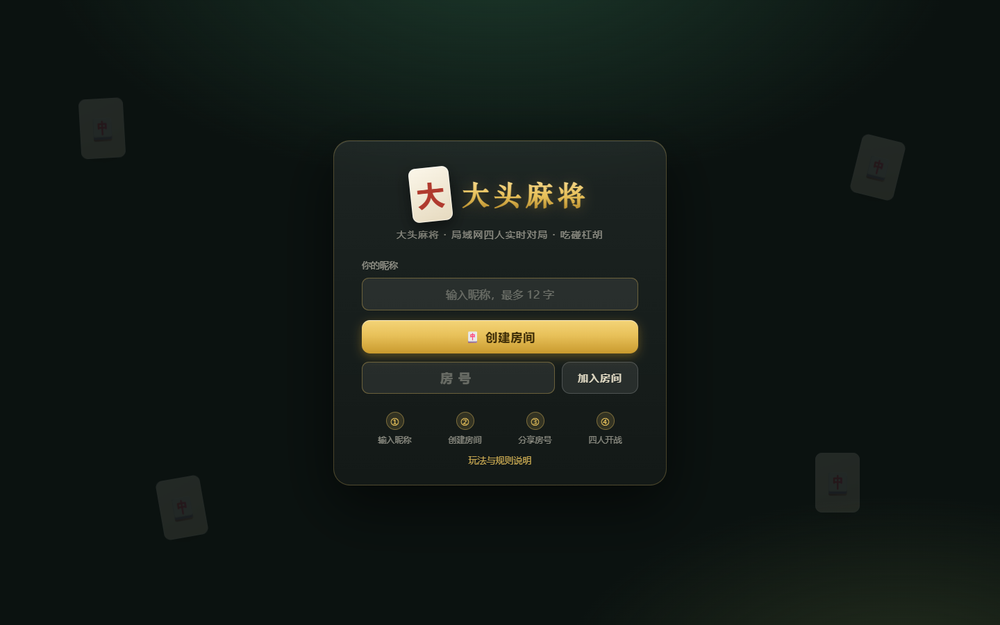
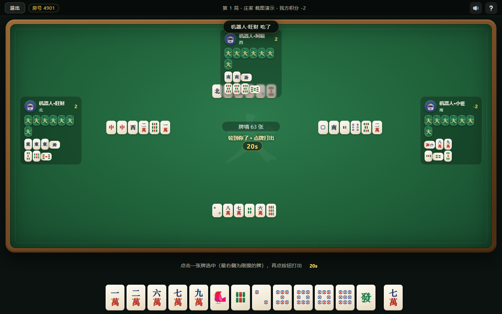

# 🀄 大头麻将 · datou-mahjong-lan

[](LICENSE)
[](https://nodejs.org/)
[](package.json)

**零依赖的局域网四人麻将 Web 游戏**。无需 `npm install`、无需数据库、无需任何图片素材，一条命令启动，同一局域网内的手机 / 平板 / 电脑用浏览器打开即玩。

```bash
node server.js
```

就这一条。

## 📸 截图

| 首页 | 大厅（机器人补位） |
| :---: | :---: |
|  |  |

| 对局 |
| :---: |
|  |

## ✨ 特性

- **真正的零依赖**：服务端只用 Node.js 内置模块，连 WebSocket 都是手写实现（`wsmini.js`，RFC 6455），clone 下来直接跑
- **完整麻将流程**：吃 / 碰 / 杠 / 胡、自摸、暗杠 / 补杠、抢杠胡、七对、杠上开花、流局连庄
- **房间制联机**：4 位房号 + 一键复制邀请链接（`#房号` 直达），支持 2~4 名真人混合机器人开局
- **机器人补位与断线托管**：人不够机器人凑；对局中断线由机器人托管，相同昵称重连即可接管原座位
- **服务端权威状态机**：所有判定在服务端完成，每个玩家只收到自己的手牌视角，防窥牌
- **对局节奏控制**：出牌限时 20 秒（超时自动代打）、吃碰杠胡响应限时 10 秒、结算 15 秒自动续局
- **纯手绘 UI**：麻将牌面全部用 CSS 绘制，零图片素材；WebAudio 合成音效，可一键静音
- **响应式布局**：电脑和手机浏览器都能玩

## 🚀 快速开始

### 环境要求

- Node.js **>= 18**（使用了 `Array.prototype.findLastIndex`）。仅此而已。

### 启动

```bash
git clone https://github.com/<你的用户名>/datou-mahjong-lan.git
cd datou-mahjong-lan
node server.js
```

启动后控制台会打印所有可访问地址：

```
┌──────────────────────────────────────────┐
  🀄 大头麻将已启动（局域网四人联机）
  本机游玩:   http://localhost:8420
  局域网访问: http://192.168.1.23:8420
  停止服务: Ctrl+C
└──────────────────────────────────────────┘
```

### 自定义端口

```bash
# macOS / Linux
PORT=9000 node server.js

# Windows PowerShell
$env:PORT=9000; node server.js
```

## 🌐 局域网联机步骤

1. 在任意一台机器上运行 `node server.js`；
2. 同一局域网的每台设备（手机 / 平板 / 电脑均可）用浏览器打开 `http://<主机IP>:8420`；
3. 第一位玩家输入昵称 → **创建房间**，得到 4 位房号（可一键复制邀请链接发给朋友）；
4. 其他玩家输入昵称 + 房号加入；不足 4 人时房主可**添加机器人**补位；
5. 凑满 4 个座位后，房主点击**开始对局**。

> **其他设备打不开？** 检查主机防火墙是否放行了 Node.js（Windows 首次运行会弹提示，选"允许访问"），并确认各设备在同一网段 / 同一 Wi-Fi。

## 🎮 玩法操作

1. 轮到自己时自动摸牌（最右侧为刚摸的牌），**点击一张牌选中 → 再点一次（或点「打出」按钮）**确认打出；
2. 他人打出的牌若可**吃 / 碰 / 杠 / 胡**，屏幕下方自动弹出按钮，不想要点「过」；优先级：胡 > 碰/杠 > 吃；
3. 自己回合可**自摸胡**、**暗杠**、**补杠**（补杠可被抢杠胡）；
4. 吃只能吃上家打出的牌（标准规则）；
5. 结算面板展示牌型番数与得分，点击「准备下一局」继续，积分跨局累计；
6. 断线后用**相同昵称 + 房号**重新加入即可接管原座位。

## 🧮 规则与计分（休闲简化版）

- 136 张牌：万 / 条 / 筒 1-9 各 4 张 + 东南西北中发白各 4 张
- 和牌型：**4 面 1 将** 或 **七对**
- 番数（可叠加）：

| 牌型 | 番数 |
| --- | --- |
| 平胡 | 1 |
| 七对 | +2 |
| 对对胡 | +2 |
| 混一色 | +2 |
| 清一色 | +4 |
| 门清 | +1 |
| 自摸 | +1 |
| 杠上开花 | +1 |

- 付分：自摸三家各付番数（赢家 +3 倍）；点炮 / 被抢杠由放炮方一家付；每次杠牌其余三家即时各付 1 分
- 牌墙摸完无人胡牌 → 流局，庄家连庄

> 本规则定位为"朋友聚会开箱即玩"的休闲简化版，不追求竞技规则完整性，欢迎 fork 后改成你家乡的玩法。

## 🗂 项目结构

```
├── server.js               # HTTP 静态服务 + 房间/对局状态机 + 联机协议（服务端入口）
├── mj.js                   # 麻将规则核心：和牌判定、吃碰杠、番数计算、机器人出牌策略
├── wsmini.js               # 极简 WebSocket 服务端实现（RFC 6455，零依赖）
├── public/
│   ├── index.html          # 单页应用骨架（首页 / 大厅 / 对局三视图）
│   ├── client.js           # 前端逻辑：状态同步、渲染、交互、音效
│   └── style.css           # 纯 CSS 手绘麻将牌与牌桌
├── test/
│   └── sim.js              # 无头联机模拟：1 个模拟客户端 + 3 机器人完整打 N 局
└── docs/
    ├── screenshot-*.png    # README 截图
    └── take-screenshots.cjs # 截图脚本（需本机 Edge + playwright-core）
```

## 🛠 技术说明

- **服务端**：Node.js 内置 `http` 模块提供静态文件；房间制权威状态机，所有动作（出牌 / 吃碰杠胡 / 自摸 / 杠）都在服务端校验合法性后推进；用 token 机制清理过期定时器，避免状态错乱
- **WebSocket**：`wsmini.js` 手写 RFC 6455 协议（握手、文本帧、ping/pong、分片重组），约 160 行，省去 `ws` 依赖
- **规则核心**：`mj.js` 与传输层完全解耦，和牌判定采用递归拆分顺子/刻子 + 七对特判，可单独移植复用
- **视角隔离**：服务端按座位下发裁剪后的状态（`viewFor`），其他玩家的手牌只发数量不发牌面，结算阶段才亮牌
- **前端**：原生 HTML/CSS/JS 单页应用，无框架无构建；倒计时用相对毫秒（`deadlineIn`）下发，规避各设备时钟偏差

### 通信协议（WebSocket JSON）

客户端 → 服务端：

| 消息 | 说明 |
| --- | --- |
| `{t:'create', name}` | 创建房间 |
| `{t:'join', name, code}` | 加入 / 重连房间（同名接管断线座位） |
| `{t:'addBot'} / {t:'removeSeat', seat}` | 房主加 / 减机器人 |
| `{t:'leave'} / {t:'start'}` | 离开房间 / 房主开局 |
| `{t:'discard', id}` | 打出指定 id 的牌 |
| `{t:'claim', choice, ids?}` | 响应窗口：`hu/pong/kong/chi/pass` |
| `{t:'self', choice, code?}` | 自摸回合动作：`hu` / `gang` |
| `{t:'ready'}` | 结算后准备下一局 |

服务端 → 客户端：`state`（按座位裁剪的完整状态快照）、`err`、`left`。前端以快照驱动渲染，天然支持断线重连。

## ✅ 测试

内置无头联机模拟测试：用裸 TCP 实现了一个 WebSocket 客户端，模拟"1 真人 + 3 机器人"完整打 N 局，验证状态机不崩溃。

```bash
# 先启动服务端
node server.js

# 另开一个终端（默认跑 3 局，ROUNDS 可调整）
node test/sim.js
ROUNDS=10 node test/sim.js
```

## ⚠️ 适用场景与限制

- 面向**可信任的局域网环境**（家庭、办公室聚会），未做账号体系 / HTTPS / 防作弊审计，请勿直接暴露到公网
- 房间状态存于单进程内存，服务重启后所有房间清空
- 计分规则为休闲简化版，不含地方特色番种（如国标、川麻血战等）

## 🤝 贡献

欢迎 Issue 和 Pull Request！一些可以着手的方向：

- 地方玩法变体（血战到底、广东麻将等，规则核心 `mj.js` 已解耦）
- 观战模式 / 战绩持久化
- 更聪明的机器人策略
- 移动端手感优化

## 📄 许可证

[MIT](LICENSE) © 大头麻将贡献者
